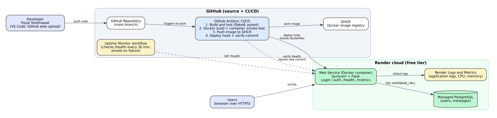
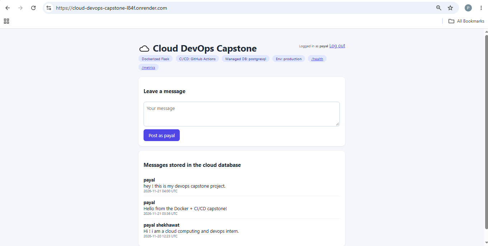
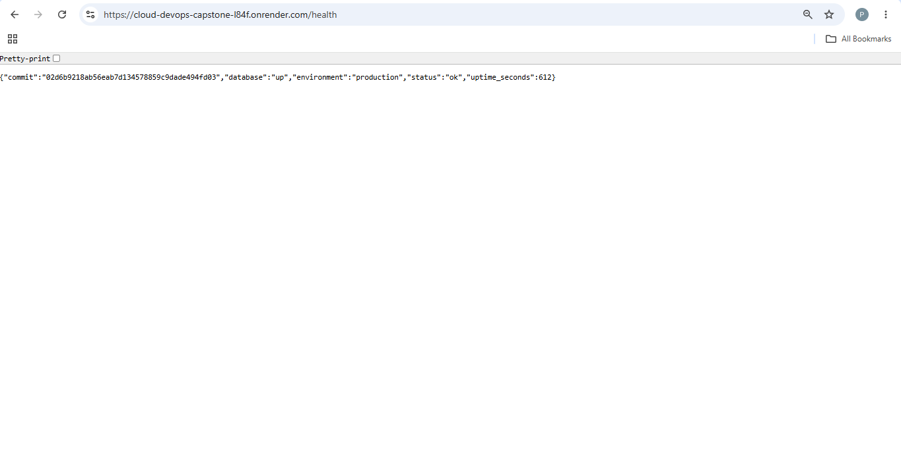
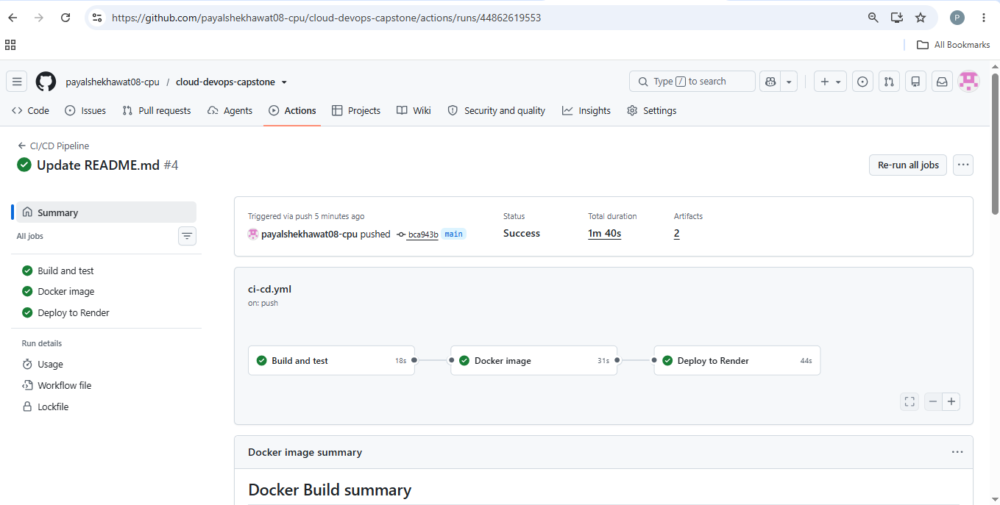
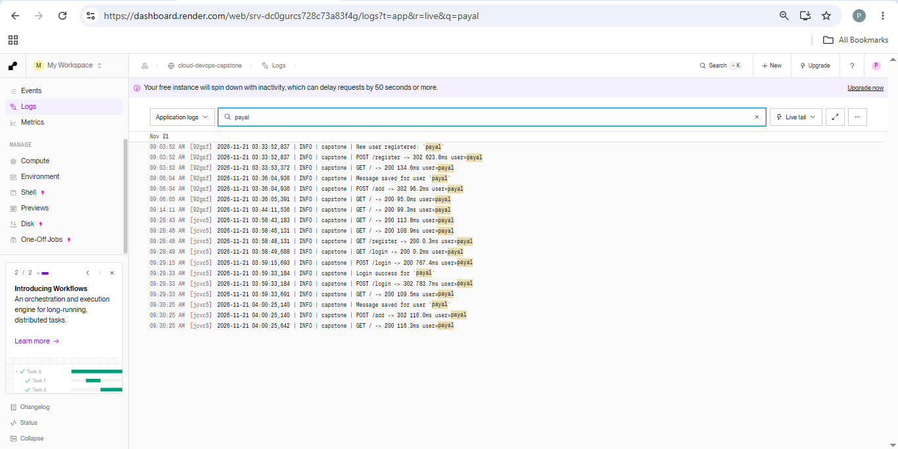

# ☁️ Cloud DevOps Capstone: Build, Containerize, Automate, Deploy and Monitor

A small but complete web application taken through the full DevOps life cycle: **Git → CI/CD pipeline → Docker → cloud deployment → managed database → monitoring**.

**Live website:** https://cloud-devops-capstone.onrender.com/
(free tier: if the site was idle, the first load can take about a minute to wake up)

**Author:** Payal Shekhawat

## What the application does
A message board with user accounts. Visitors create an account, log in and post messages that are stored in a managed PostgreSQL database. The app also exposes `/health` and `/metrics` endpoints for monitoring.

## Architecture


1. The code is pushed to **GitHub** (`main` branch).
2. **GitHub Actions** runs the pipeline: build and test, build the Docker image and smoke-test the container, push the image to GitHub Container Registry (GHCR), then trigger a deploy on Render.
3. **Render** builds the `Dockerfile` and runs the container as a web service with managed HTTPS.
4. The app talks to a **managed PostgreSQL** database through the `DATABASE_URL` environment variable.
5. After a deploy, the pipeline polls `/health` until the live site reports the new commit id.
6. A scheduled **Uptime Monitor** workflow checks `/health` every 30 minutes and fails (so GitHub sends an email) if the site or database is down.

## Task requirements and how they are covered
| Requirement | What was done | Where to look |
|---|---|---|
| Build a real application | Flask web app with sign-up, login and a message board | `app.py`, `templates/` |
| Git / version control | Source in GitHub; pipeline runs on every push and pull request | `.github/workflows/ci-cd.yml` |
| Containerize with Docker | Slim Python image, non-root user, layer caching, built-in `HEALTHCHECK` | `Dockerfile`, `.dockerignore` |
| Docker Compose | Local stack with the web app and a PostgreSQL container, health-gated start-up | `docker-compose.yml` |
| CI/CD pipeline | Test (flake8 + pytest) → Docker build + container smoke test → push to GHCR → deploy → verify live commit | `.github/workflows/ci-cd.yml` |
| Cloud infrastructure | Render web service (runtime: Docker) defined as code | `render.yaml` |
| Managed database | Render PostgreSQL, connected only through an environment variable | `DATABASE_URL`, `init_db()` in `app.py` |
| Authentication | Registration and login, passwords hashed with scrypt (Werkzeug), CSRF tokens, HttpOnly + Secure + SameSite cookies, users stored in the managed database | `app.py` |
| Active monitoring | `/health` (app + database), `/metrics` (Prometheus text format), scheduled uptime check, Docker health check, Render health check, structured logs | `app.py`, `.github/workflows/uptime.yml` |
| Secrets and configuration | `SECRET_KEY` and `DATABASE_URL` live only in the platform environment or GitHub secrets, never in code; the app refuses to start in production without a `SECRET_KEY` | `render.yaml`, `.env.example` |
| Architecture diagram | Included above | `docs/architecture.png` |

## Tech stack
Python 3.12, Flask, SQLAlchemy, Gunicorn, PostgreSQL, Docker, Docker Compose, GitHub Actions, GitHub Container Registry, Render.

## Project structure
```
├── app.py                         # Flask app: auth, routes, DB, logging, /health, /metrics
├── templates/                     # base, login/register and message board pages
├── tests/test_app.py              # automated tests run by the pipeline
├── Dockerfile                     # container image
├── docker-compose.yml             # app + PostgreSQL for local use
├── render.yaml                    # cloud service definition (infrastructure as code)
├── .github/workflows/
│   ├── ci-cd.yml                  # build, test, Docker, deploy, verify
│   └── uptime.yml                 # scheduled health monitor
├── docs/
│   ├── architecture.png           # architecture diagram
│   └── architecture.dot           # diagram source (Graphviz)
├── requirements.txt
├── .env.example
├── *.png                          # screenshots used in this README
└── README.md
```

## CI/CD pipeline details
| Stage | What happens | Fails the pipeline when |
|---|---|---|
| Build and test | Installs dependencies, runs flake8 and 9 pytest tests (health, login, CSRF, metrics, ...) | lint or any test fails |
| Docker image | Builds the image, starts the container and calls `/health`; on `main` pushes `:latest` and `:<commit>` tags to GHCR | build fails or the container is not healthy |
| Deploy | Calls the Render deploy hook, then polls `/health` until the live site reports this exact commit | the site does not show the new commit within about 13 minutes |

Pipeline settings (added once in GitHub, never stored in the code):
- Secret `RENDER_DEPLOY_HOOK`: the deploy hook URL of the Render service
- Variable `APP_URL`: the live site URL, used by the verify step and the uptime monitor

## Run locally with Docker Compose
```bash
docker compose up --build
# open http://localhost:5000, create an account, post a message
# stop with Ctrl+C, then: docker compose down
```
Without Docker (uses SQLite): `pip install -r requirements.txt` then `python app.py`.

Run the tests: `pip install pytest && pytest -q`

## Deploy to the cloud (Render free tier)
1. Push this repository to GitHub.
2. In Render choose **New → Blueprint**, select this repository and paste the PostgreSQL connection URL when asked for `DATABASE_URL`.
3. In the Render service open **Settings → Deploy Hook**, copy the URL and save it as the GitHub secret `RENDER_DEPLOY_HOOK`.
4. Save the live URL as the GitHub variable `APP_URL`.
5. Push any change to `main`; the pipeline tests, builds, pushes and deploys it.

## Monitoring
| What | How to see it |
|---|---|
| Health of app and database | `/health` returns JSON with `status`, `database`, `commit` and uptime (HTTP 503 if the database is down) |
| Request counts, latency, login results | `/metrics` (Prometheus text format) |
| Uptime alerts | GitHub → Actions → *Uptime Monitor* (failed runs send an email) |
| Application logs | Render dashboard → service → *Logs* (timestamped, one line per request) |
| CPU and memory | Render dashboard → service → *Metrics* |
| Container health | `docker ps` shows `healthy` (from the `HEALTHCHECK` in the Dockerfile) |

## Security notes
- Passwords are never stored in plain text (scrypt hashes).
- Every form is protected by a CSRF token; cookies are HttpOnly, SameSite=Lax and Secure in production.
- There is no default account; every user registers their own.
- This is a learning project: it has no rate limiting, e-mail verification or password reset.
- Authentication is implemented inside the app and stored in the managed database; it does not use an external identity provider.

## Free-tier limits worth knowing
- Render free web services sleep after about 15 minutes without traffic and need about a minute to wake up.
- A free Render PostgreSQL database expires 30 days after it is created (a new free one can then be created and its URL pasted into `DATABASE_URL`).
- The app runs one Gunicorn worker with 4 threads, which keeps the in-memory `/metrics` counters accurate and stays inside the 512 MB memory limit.

## Screenshots
### Live website (after login)


### Health check endpoint


### CI/CD pipeline run (all jobs green)


### Application logs on Render


## Author
**Payal Shekhawat**
